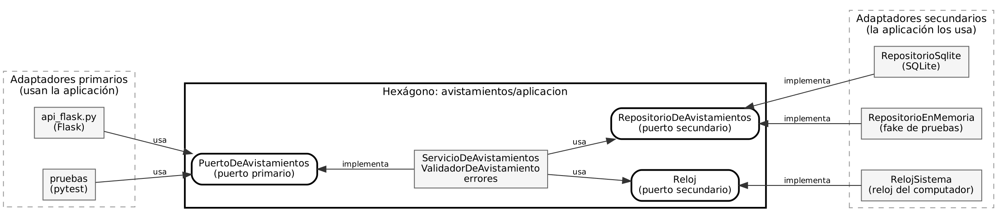

# API REST de avistamientos de aves

Trabajo de Ingeniería de Software 2 (ISW-2). En la Sesión 17 se construyó la API, en la Sesión 22 se le escribieron pruebas unitarias y de integración, y en el Taller 5 se reorganizó con arquitectura hexagonal (puertos y adaptadores).

API REST para registrar avistamientos de aves. Permite crear, consultar, actualizar y eliminar avistamientos. Los datos se guardan en una base de datos SQLite y la API recibe y responde en JSON.

Autor: Nicolas Esteban Matheus

## Tecnologías

- Python 3.10 o superior
- Flask (framework web)
- SQLite, con el módulo `sqlite3` que ya trae Python
- pytest y pytest-cov (pruebas y cobertura)

## Requisitos

- Python 3.10 o superior
- Git
- curl (ya viene en Windows 10/11, macOS y Linux)

## Instalación y ejecución

1. Clonar el repositorio:

```
git clone https://github.com/nicolasmatheus71/api-avistamientos.git
cd api-avistamientos
```

2. Crear y activar el entorno virtual.

Windows (PowerShell):

```
python -m venv .venv
.\.venv\Scripts\Activate.ps1
```

Si PowerShell dice que la ejecución de scripts está deshabilitada, ejecutar esto y volver a activar:

```
Set-ExecutionPolicy -Scope Process RemoteSigned
```

Linux o macOS:

```
python3 -m venv .venv
source .venv/bin/activate
```

3. Instalar las dependencias:

```
pip install -r requirements.txt
```

4. Ejecutar la API:

```
python app.py
```

La API queda disponible en `http://127.0.0.1:5000`. La base de datos (`avistamientos.db`) se crea sola la primera vez que se ejecuta.

Si el puerto 5000 está ocupado (en macOS suele usarlo AirPlay), se puede usar otro puerto con la variable `PORT`:

- Windows (PowerShell): `$env:PORT=5001; python app.py`
- Linux o macOS: `PORT=5001 python app.py`

## Recurso: avistamiento

| Campo | Tipo | Descripción |
|---|---|---|
| id | número | Lo asigna el sistema |
| especie | texto | Nombre de la especie, por ejemplo "colibrí" |
| lugar | texto | Dónde se observó |
| fecha | texto | Formato AAAA-MM-DD |
| observador | texto | Quién lo registró |

### Reglas de validación

Un avistamiento es válido si cumple todo esto. Si no, POST y PUT responden 400 e indican qué campo falló.

| Campo | Regla |
|---|---|
| especie | Obligatoria, entre 3 y 50 caracteres (sin contar los espacios de los extremos) |
| lugar | No puede estar vacío |
| fecha | Formato AAAA-MM-DD, debe ser una fecha real y no puede ser posterior a hoy |
| observador | No puede estar vacío |

## Endpoints

| Acción | Petición | Respuesta |
|---|---|---|
| Listar todos | GET /avistamientos | 200 con la lista |
| Ver uno | GET /avistamientos/{id} | 200, o 404 si no existe |
| Registrar | POST /avistamientos | 201 con el avistamiento creado, o 400 si los datos no son válidos |
| Actualizar | PUT /avistamientos/{id} | 200, 404 si no existe, o 400 si los datos no son válidos |
| Eliminar | DELETE /avistamientos/{id} | 204 sin contenido, o 404 si no existe |
| Resumen por especie | GET /avistamientos/resumen | 200 con la cantidad por especie |

## Ejemplos con curl

Los ejemplos usan los archivos JSON de la carpeta `ejemplos/`. Se deben ejecutar desde la raíz del proyecto, con la API corriendo en otra terminal. En Windows PowerShell hay que escribir `curl.exe` en lugar de `curl`.

Se recomienda seguirlos en orden, porque el primero crea el avistamiento con id 1.

### Registrar un avistamiento (POST)

```
curl -i -X POST http://127.0.0.1:5000/avistamientos -H "Content-Type: application/json" -d @ejemplos/nuevo.json
```

Respuesta: `201 Created`

```json
{"especie":"colibrí","fecha":"2026-10-04","id":1,"lugar":"Bogotá","observador":"Laura"}
```

### Listar todos (GET)

```
curl -i http://127.0.0.1:5000/avistamientos
```

Respuesta: `200 OK`

```json
[{"especie":"colibrí","fecha":"2026-10-04","id":1,"lugar":"Bogotá","observador":"Laura"}]
```

### Ver uno (GET)

```
curl -i http://127.0.0.1:5000/avistamientos/1
```

Respuesta: `200 OK` con el avistamiento. Si el id no existe, responde `404 Not Found`:

```json
{"error":"Avistamiento no encontrado"}
```

### Actualizar (PUT)

```
curl -i -X PUT http://127.0.0.1:5000/avistamientos/1 -H "Content-Type: application/json" -d @ejemplos/actualizado.json
```

Respuesta: `200 OK`

```json
{"especie":"águila","fecha":"2026-10-05","id":1,"lugar":"Chingaza","observador":"Laura"}
```

### Resumen por especie (opcional)

```
curl -i http://127.0.0.1:5000/avistamientos/resumen
```

Respuesta: `200 OK`

```json
[{"cantidad":1,"especie":"águila"}]
```

### Eliminar (DELETE)

```
curl -i -X DELETE http://127.0.0.1:5000/avistamientos/1
```

Respuesta: `204 No Content` (sin cuerpo). Si el id no existe, responde `404 Not Found`.

### Ejemplo de error 400

```
curl -i -X POST http://127.0.0.1:5000/avistamientos -H "Content-Type: application/json" -d @ejemplos/incompleto.json
```

Respuesta: `400 Bad Request`

```json
{"campos":{"fecha":"es obligatoria","lugar":"es obligatorio","observador":"es obligatorio"},"error":"Datos inválidos en: lugar, observador, fecha"}
```

El campo `campos` indica qué campo falló y por qué.

## Códigos de estado

| Código | Cuándo se usa |
|---|---|
| 200 | La consulta o la actualización salió bien |
| 201 | El avistamiento se creó |
| 204 | El avistamiento se eliminó (no devuelve cuerpo) |
| 400 | Los datos no cumplen las reglas de validación o el cuerpo no es un JSON válido |
| 404 | El avistamiento o la ruta no existe |
| 405 | El método HTTP no está permitido en esa ruta |

## Pruebas

Hay 47 pruebas en la carpeta `tests/`:

- `test_validador.py`: 16 unitarias del validador, con un reloj fijo (un stub) para que la fecha de hoy no cambie el resultado.
- `test_api.py`: 22 de integración que prueban la API completa por HTTP; cada una usa su propia base de datos SQLite temporal.
- `test_servicio.py`: 8 unitarias del servicio, sin Flask y sin SQLite, con un repositorio en memoria (un fake).
- `test_arquitectura.py`: 1 prueba que revisa que el hexágono (`avistamientos/aplicacion/`) no importe Flask, SQLite ni los adaptadores.

Con el entorno virtual activo:

Correr todas las pruebas:

```
pytest
```

Generar el reporte de cobertura (de sentencias y de ramas):

```
pytest --cov=app --cov=avistamientos --cov-branch --cov-report=term-missing
```

La cobertura total es del 98 %. La aplicación (`avistamientos/aplicacion/`) está al 100 %.

La justificación de las pruebas está en `docs/justificacion_pruebas.md` y el documento del Taller 5 (arquitectura hexagonal) en `docs/taller5_arquitectura_hexagonal.md`.

## Arquitectura

El código sigue la arquitectura hexagonal (puertos y adaptadores) de Alistair Cockburn. La aplicación está en el centro y no conoce Flask ni SQLite; se comunica con el exterior por puertos (interfaces) que implementan los adaptadores.



## Estructura del proyecto

```
api-avistamientos/
├── app.py                         # Arranque: conecta cada puerto con su adaptador
├── avistamientos/
│   ├── aplicacion/                # El hexágono (no importa Flask ni SQLite)
│   │   ├── puertos.py             # Puerto primario y puertos secundarios
│   │   ├── servicio.py            # ServicioDeAvistamientos (implementa el puerto primario)
│   │   ├── validador.py           # Regla de negocio
│   │   └── errores.py             # Errores de la aplicación
│   └── adaptadores/
│       ├── primarios/
│       │   └── api_flask.py       # Rutas Flask
│       └── secundarios/
│           ├── repositorio_sqlite.py  # Guarda en SQLite
│           └── reloj_sistema.py       # Fecha del computador
├── scripts/
│   └── muestra_api.py             # Peticiones fijas para comparar respuestas
├── ejemplos/                      # JSON de ejemplo para los curl
├── docs/
│   ├── justificacion_pruebas.md
│   ├── taller5_arquitectura_hexagonal.md
│   ├── diagrama_dependencias.dot / .png
│   └── evidencias/                # Pruebas, cobertura y API antes y después del refactor
├── tests/
├── requirements.txt
└── pytest.ini
```

## Decisiones de diseño

- PUT reemplaza el avistamiento completo, por eso exige todos los campos.
- DELETE responde 204 sin cuerpo.
- Las consultas SQL usan parámetros (`?`) para evitar inyección SQL.
- La validación vive en la clase `ValidadorDeAvistamiento`, dentro del hexágono, y la usa el servicio en POST y PUT.
- La fecha de hoy llega por el puerto `Reloj`, para poder reemplazarlo por uno fijo en las pruebas.
- El repositorio de SQLite no depende de Flask: abre y cierra una conexión por operación.
- El servicio lanza errores sin HTTP (`AvistamientoNoEncontrado`, `DatosInvalidos`) y el adaptador de Flask los convierte en 404 y 400.
- Los errores también se devuelven en JSON.

## Uso de inteligencia artificial

Se usó IA como apoyo para planear y escribir el código y las pruebas: Claude (Anthropic), modelo Claude Sonnet 5.5. En el Taller 5 también se usó Claude (Anthropic) para planear el refactor por pasos y revisar el documento.