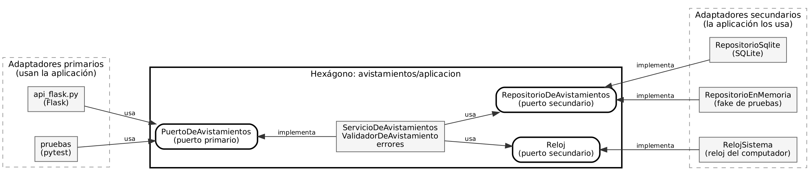
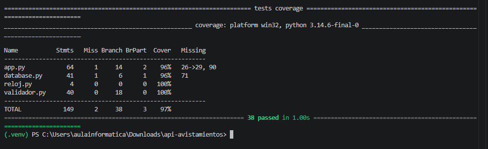
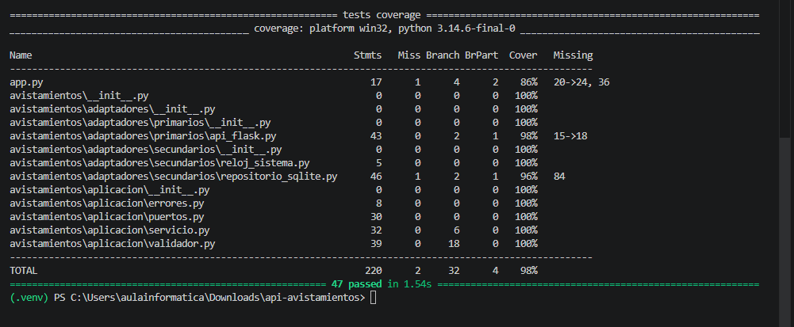

# Taller 5: Clean Architecture y arquitectura hexagonal

Ingeniería de Software 2 (ISW-2). Miércoles 11 de noviembre de 2026. Trabajo individual.

Autor: Nicolas Esteban Matheus

- Repositorio: https://github.com/nicolasmatheus71/api-avistamientos
- Rama: `arquitectura-hexagonal`
- Arquitectura elegida: **hexagonal (puertos y adaptadores), de Cockburn (2005)**

---

## Parte 1. Investigación

### 1. El problema de Cockburn, puertos, adaptadores y la simetría

Cockburn (2005) parte de un problema que veía en muchas aplicaciones: la lógica de negocio se filtra dentro del código de la interfaz de usuario. Cuando eso pasa, la aplicación no se puede probar con pruebas automáticas, no se puede correr en modo batch y otro programa no la puede usar, porque todo pasa por la pantalla. Él muestra que en el otro extremo pasa lo mismo: si la aplicación está amarrada a la base de datos, cuando la base se cae o se cambia el equipo no puede seguir trabajando. Para Cockburn (2005) la causa de los dos problemas es la misma: la lógica de negocio está enredada con la forma de hablar con las entidades externas, y las arquitecturas por capas no logran impedir que eso se cuele.

En su propuesta, un **puerto** es una interfaz que la aplicación define según el propósito de una conversación con el exterior, por ejemplo "registrar avistamientos" o "guardar avistamientos". Un **adaptador** es el código que traduce entre ese puerto y una tecnología concreta: una interfaz gráfica, un arnés de pruebas, una base de datos SQL o una base falsa en memoria (Cockburn, 2005). Por cada puerto puede haber varios adaptadores, y cambiar de uno a otro no toca la aplicación. Cockburn (2005) distingue entre actores primarios, que manejan la aplicación (un usuario, un script de pruebas), y actores secundarios, que la aplicación maneja a ella (la base de datos).

La **simetría** viene de que, para Cockburn (2005), la división importante no es izquierda y derecha, ni arriba y abajo como en las capas, sino adentro y afuera de la aplicación. El usuario y la base de datos son los dos "afuera": ambos se conectan por un puerto y un adaptador, y ambos se pueden reemplazar. Igual que un arnés de pruebas puede reemplazar al usuario, una base de datos en memoria puede reemplazar a la real, y así la aplicación corre completamente aislada (Cockburn, 2005). Por eso tampoco importa que la figura sea un hexágono: la forma solo deja espacio para dibujar tantos puertos como se necesiten, sin la idea de capas apiladas.

### 2. Los círculos de Clean Architecture y la regla de dependencia

Martin (2012) dibuja cuatro círculos concéntricos. En el centro están las **entidades**, que guardan las reglas de negocio más generales de la empresa y que menos cambian cuando cambia algo externo. Luego vienen los **casos de uso**, con las reglas propias de esta aplicación: coordinan el flujo de datos hacia las entidades y desde ellas para cumplir un objetivo. El tercer círculo son los **adaptadores de interfaz**, que convierten los datos entre el formato que le sirve a los casos de uso y el que le sirve a la web o a la base de datos; ahí van los controladores, los presentadores y el SQL. Afuera están los **frameworks y drivers**, como el framework web y la base de datos, donde casi solo hay código de pegamento (Martin, 2012). Martin aclara que los cuatro círculos son un esquema y que puede haber más.

La **regla de dependencia** dice que las dependencias del código fuente solo pueden apuntar hacia adentro (Martin, 2012). Es decir, un círculo interno no puede saber nada de uno externo: no puede nombrar sus clases, funciones ni variables, y tampoco puede usar formatos de datos que vengan de afuera, como la estructura de fila que entrega un framework de base de datos. Lo que prohíbe, entonces, es que la política de alto nivel (las reglas de negocio) dependa de los detalles (la web, la base de datos, el framework). El código de afuera sí puede depender del de adentro; al revés, nunca (Martin, 2012).

### 3. Cómo guarda datos un caso de uso sin depender de la base de datos

La contradicción es que el flujo de control va de adentro hacia afuera (el caso de uso llama a quien guarda), pero la dependencia del código tiene que ir de afuera hacia adentro. Martin (2012) la resuelve con el **principio de inversión de dependencias**: el caso de uso no llama a la clase de la base de datos, sino a una interfaz que se declara en el círculo interno. La clase de la base de datos, que está afuera, implementa esa interfaz. Así, en tiempo de ejecución la llamada sí llega hasta la base de datos, pero en el código fuente es la base de datos la que depende del caso de uso y no al revés. Martin (2012) lo explica con el presentador y el puerto de salida del caso de uso, y Palermo (2008) dice lo mismo para los repositorios: la interfaz la define el núcleo y la implementación queda en el borde, y se inyecta al arrancar.

En mi API quedó así. El servicio `ServicioDeAvistamientos` necesita guardar, pero solo conoce la interfaz `RepositorioDeAvistamientos`, que está en `avistamientos/aplicacion/puertos.py`. La clase `RepositorioSqlite`, que está en `avistamientos/adaptadores/secundarios/`, importa esa interfaz y la implementa con SQL. Por último, `app.py` crea el `RepositorioSqlite` y se lo pasa al servicio por el constructor. Cuando el servicio llama `self._repositorio.crear(datos)`, el control llega a SQLite, pero el archivo del servicio nunca importa `sqlite3`. Por eso en las pruebas se le puede pasar un `RepositorioEnMemoria` en vez de SQLite sin cambiar nada del servicio, que es justo lo que proponen Cockburn (2005) y el principio de inversión de dependencias de SOLID.

### 4. Comparación de las tres arquitecturas

Las tres tienen el mismo fondo. Martin (2012) lo dice explícitamente: la hexagonal, la de cebolla y otras se diferencian en detalles, pero todas separan las reglas de negocio de las interfaces, y producen sistemas independientes del framework, de la interfaz de usuario y de la base de datos, y que se pueden probar sin ellos. Las tres ponen el negocio en el centro, hacen que las dependencias apunten hacia ese centro y tratan la base de datos y la web como detalles reemplazables. Palermo (2008) reconoce que su propuesta parte de la misma premisa que la hexagonal de Cockburn: sacar la infraestructura afuera y conectarla con código adaptador. Y en las tres el mecanismo es el mismo: el centro define interfaces y el borde las implementa (Cockburn, 2005; Palermo, 2008; Martin, 2012).

Lo que cambia es más que el vocabulario. La **hexagonal** solo distingue adentro y afuera; no dice nada de capas dentro de la aplicación y se enfoca en la simetría entre quien usa la aplicación y lo que la aplicación usa (Cockburn, 2005). La de **cebolla** sí organiza el centro en anillos: el modelo de dominio en el núcleo, las interfaces de repositorio en el anillo siguiente y la interfaz de usuario, la infraestructura y las pruebas en el borde; el número de anillos depende de la aplicación y pone énfasis en la orientación a objetos (Palermo, 2008). **Clean Architecture** propone cuatro círculos con nombre (entidades, casos de uso, adaptadores de interfaz, frameworks) y agrega reglas precisas sobre qué datos pueden cruzar las fronteras (Martin, 2012).

| | Hexagonal (Cockburn, 2005) | Cebolla (Palermo, 2008) | Clean (Martin, 2012) |
|---|---|---|---|
| Cómo divide | Adentro / afuera | Anillos alrededor del dominio | Cuatro círculos (o más) |
| Centro | La aplicación | El modelo de dominio | Las entidades |
| Palabras clave | Puerto, adaptador, actor primario y secundario | Núcleo, repositorio, infraestructura externa | Caso de uso, regla de dependencia, frontera |
| Énfasis | Simetría y poder probar todo aislado | Desacoplar del acceso a datos | Dirección de dependencias y datos en las fronteras |

### 5. ¿Se justifica en una API tan pequeña?

Mi posición es que **se justifica en una versión ligera**, no en la versión completa. El costo es real. Pasé de cuatro módulos a trece archivos, agregué tres interfaces abstractas y ahora, para seguir una petición, hay que pasar por la ruta de Flask, el puerto, el servicio, otro puerto y el repositorio. Para seis endpoints y una sola regla de validación eso es más código del que el problema pide. El mismo Palermo (2008) dice que su arquitectura es para aplicaciones de negocio de larga vida con comportamiento complejo, y no para sitios web pequeños. Si hubiera aplicado Clean Architecture completa, con entidades, DTO y presentadores aparte, el costo habría sido mayor que el beneficio.

El beneficio también es concreto y lo pude medir. Después del refactor escribí 8 pruebas del servicio que corren sin Flask y sin SQLite, con un repositorio en memoria, como propone Cockburn (2005); antes eso no se podía hacer, porque la lógica estaba mezclada con las rutas. Además, el repositorio de SQLite dejó de depender de Flask, así que cambiar de base de datos (por ejemplo a PostgreSQL) solo exige un adaptador nuevo y cambiar una línea en `app.py`, y la web o la base de datos pasan a ser un detalle, como dice Martin (2012). Como mi API ya tenía medio camino hecho desde el taller de pruebas (validador separado y reloj inyectado), el costo de terminar de separar fue bajo. Por eso creo que vale la pena, siempre que se quede en lo mínimo: puertos donde hay una tecnología externa real y nada más.

---

## Parte 2. Aplicación

### 2.1 Arquitectura elegida

Elegí la **arquitectura hexagonal (puertos y adaptadores)** de Cockburn (2005), porque mi API ya tenía dos piezas que encajaban en esa idea: el validador separado de Flask y el reloj que se pasaba desde afuera (que en la práctica ya era un puerto). Además la hexagonal no obliga a inventar capas internas que esta API no necesita. Usé solo su vocabulario: **aplicación** (el hexágono), **puertos primarios y secundarios** y **adaptadores primarios y secundarios**. No usé nombres de las otras dos, como "entidades", "casos de uso", "infraestructura" o "dominio", para no mezclarlas.

Las reglas que seguí:

- Todo lo que está en `avistamientos/aplicacion/` (el hexágono) no importa Flask, ni `sqlite3`, ni nada de `adaptadores/`. Esto lo revisa una prueba automática (`tests/test_arquitectura.py`).
- Los puertos los define el hexágono (`puertos.py`) y los adaptadores los implementan.
- `app.py` es el único archivo que conoce todas las piezas: solo las conecta al arrancar.

### 2.2 Estructura de carpetas

Antes:

```
api-avistamientos/
├── app.py           # rutas + validación + respuestas, todo junto
├── database.py      # SQL, pero usando flask.g y current_app
├── validador.py
├── reloj.py
└── tests/
```

Después:

```
api-avistamientos/
├── app.py                         # arma el hexágono: conecta puertos con adaptadores
├── avistamientos/
│   ├── aplicacion/                # EL HEXÁGONO (no conoce Flask ni SQLite)
│   │   ├── puertos.py             # PuertoDeAvistamientos (primario), RepositorioDeAvistamientos y Reloj (secundarios)
│   │   ├── servicio.py            # ServicioDeAvistamientos: implementa el puerto primario
│   │   ├── validador.py           # regla de negocio
│   │   └── errores.py             # AvistamientoNoEncontrado, DatosInvalidos
│   └── adaptadores/
│       ├── primarios/
│       │   └── api_flask.py       # rutas Flask: HTTP/JSON <-> puerto primario
│       └── secundarios/
│           ├── repositorio_sqlite.py  # implementa RepositorioDeAvistamientos con SQLite
│           └── reloj_sistema.py       # implementa Reloj con la fecha del computador
├── scripts/
│   └── muestra_api.py             # peticiones fijas para comparar antes y después
├── docs/
│   ├── taller5_arquitectura_hexagonal.md
│   ├── diagrama_dependencias.dot / .png
│   └── evidencias/                # salidas de pruebas, cobertura y API (antes y después)
└── tests/
    ├── test_api.py                # integración (sin cambios)
    ├── test_validador.py          # unitarias del validador (solo cambió el import)
    ├── test_servicio.py           # NUEVAS: servicio con repositorio en memoria
    └── test_arquitectura.py       # NUEVA: el hexágono no importa el exterior
```

### 2.3 Diagrama de dependencias

Cada flecha va del archivo que importa al archivo importado. Todas las flechas apuntan hacia el hexágono: los adaptadores dependen de los puertos y nunca al revés. `app.py` no aparece porque solo conecta las piezas al arrancar.



El recorrido de una petición `POST /avistamientos` es: `api_flask.py` recibe el JSON y llama `puerto.registrar(datos)` → `ServicioDeAvistamientos` valida con `ValidadorDeAvistamiento` (que pregunta la fecha al puerto `Reloj`) → si hay errores lanza `DatosInvalidos`, y si no, llama `repositorio.crear(...)` → `RepositorioSqlite` hace el `INSERT`. De vuelta, `api_flask.py` convierte el resultado en `201` o el error en `400`.

### 2.4 Commits

Hice el refactor en la rama `arquitectura-hexagonal`, en pasos pequeños. Después de cada commit corrí `pytest` y las pruebas pasaban.

| # | Commit | Qué cambió |
|---|---|---|
| 1 | Evidencias del antes | Script `muestra_api.py`, salida de pruebas, cobertura y API antes del refactor |
| 2 | Crea el hexágono | Carpeta `avistamientos/aplicacion/`, `puertos.py`, el validador se mueve adentro y deja de importar el reloj del sistema |
| 3 | Adaptadores secundarios | `RepositorioSqlite` (sin Flask) y `RelojSistema` reemplazan a `database.py` y `reloj.py` |
| 4 | Servicio y errores | `ServicioDeAvistamientos` implementa el puerto primario; las rutas ya no validan ni hablan con la base |
| 5 | Adaptador primario | Las rutas pasan a `api_flask.py`; `app.py` queda solo armando las piezas |
| 6 | Pruebas nuevas | `test_servicio.py` (repositorio en memoria) y `test_arquitectura.py` |
| 7 | Documento y evidencias del después | Este documento, el diagrama, evidencias y README |

### 2.5 Evidencia antes y después

Comandos usados:

```
# Antes
pytest -v --cov=app --cov=database --cov=validador --cov=reloj --cov-branch --cov-report=term-missing
# Después (los módulos ahora están en el paquete avistamientos)
pytest -v --cov=app --cov=avistamientos --cov-branch --cov-report=term-missing
```

Las salidas completas están en `docs/evidencias/antes_pruebas_y_cobertura.txt` y `docs/evidencias/despues_pruebas_y_cobertura.txt`.

| | Antes | Después |
|---|---|---|
| Pruebas | 38 pasan | 47 pasan (las mismas 38 + 9 nuevas) |
| Cobertura total (sentencias y ramas) | 97 % | 98 % |
| Regla de negocio (validador) | 100 % | 100 % |

**Cobertura antes:**



```
Name           Stmts   Miss Branch BrPart  Cover   Missing
----------------------------------------------------------
app.py            64      1     14      2    96%   26->29, 90
database.py       41      1      6      1    96%   71
reloj.py           4      0      0      0   100%
validador.py      40      0     18      0   100%
----------------------------------------------------------
TOTAL            149      2     38      3    97%
38 passed
```

**Cobertura después:**



```
Name                                                          Stmts   Miss Branch BrPart  Cover   Missing
---------------------------------------------------------------------------------------------------------
app.py                                                           17      1      4      2    86%   20->24, 36
avistamientos/adaptadores/primarios/api_flask.py                 43      0      2      1    98%   15->18
avistamientos/adaptadores/secundarios/reloj_sistema.py            5      0      0      0   100%
avistamientos/adaptadores/secundarios/repositorio_sqlite.py      46      1      2      1    96%   84
avistamientos/aplicacion/errores.py                               8      0      0      0   100%
avistamientos/aplicacion/puertos.py                              30      0      0      0   100%
avistamientos/aplicacion/servicio.py                             32      0      6      0   100%
avistamientos/aplicacion/validador.py                            39      0     18      0   100%
---------------------------------------------------------------------------------------------------------
TOTAL                                                           220      2     32      4    98%
47 passed
```

(Se omiten los `__init__.py`, que están vacíos y al 100 %.) Las líneas sin cubrir son las mismas de antes, solo que cambiaron de archivo: en `app.py` la línea 36 es el `create_app().run(...)` que solo corre al iniciar el servidor a mano, y la rama `20->24` es cuando no se pasa configuración. En `repositorio_sqlite.py` la línea 84 es el `return None` de actualizar cuando el registro desapareció entre la consulta y el `UPDATE`, igual que la línea 71 de `database.py` antes.

Sobre las pruebas: `test_api.py` no cambió en nada, porque sigue usando `create_app(config, reloj)` igual que antes. En `test_validador.py` solo cambió la línea del import, porque el validador se movió de carpeta (`from avistamientos.aplicacion.validador import ValidadorDeAvistamiento`); las 16 pruebas son las mismas.

**La API responde igual.** Con el script `scripts/muestra_api.py` hice las mismas 15 peticiones a la API corriendo de verdad (servidor en `http://127.0.0.1:5000` y base de datos vacía), antes y después del refactor. Las peticiones cubren todos los endpoints y todos los códigos (200, 201, 204, 400, 404 y 405). Las respuestas quedaron en `docs/evidencias/antes_api.txt` y `docs/evidencias/despues_api.txt`, y al compararlas con `git diff --no-index` no sale ninguna diferencia. Muestra:

```
POST /avistamientos con nuevo.json
  -> 201 {"especie": "colibrí", "fecha": "2026-10-04", "id": 1, "lugar": "Bogotá", "observador": "Laura"}

POST /avistamientos con incompleto.json
  -> 400 {"campos": {"fecha": "es obligatoria", "lugar": "es obligatorio", "observador": "es obligatorio"}, "error": "Datos inválidos en: lugar, observador, fecha"}

PUT /avistamientos/999 con actualizado.json
  -> 404 {"error": "Avistamiento no encontrado"}

DELETE /avistamientos/1
  -> 204 (sin cuerpo)

PATCH /avistamientos
  -> 405 {"error": "Método no permitido"}
```

### 2.6 Qué fue lo más difícil de separar y por qué

Lo más difícil fue la **base de datos**, porque `database.py` parecía separado de Flask pero no lo estaba. Usaba `flask.g` para guardar la conexión de cada petición y `current_app.config` para saber la ruta del archivo, y `app.py` registraba `close_db` en el `teardown` de Flask. O sea, el adaptador de la base de datos dependía del adaptador web, y no se podía usar sin una aplicación Flask andando. Para sacarlo tuve que cambiar la forma de manejar la conexión: ahora `RepositorioSqlite` solo recibe la ruta del archivo y abre y cierra una conexión en cada operación. Con SQLite eso no cambia nada visible, pero tuve que revisar con cuidado que los `commit` siguieran pasando y que `lastrowid` y `rowcount` se leyeran antes de cerrar.

Lo segundo fue decidir **dónde va cada parte del manejo de errores**. Antes, la ruta revisaba si el avistamiento existía, validaba y armaba el mensaje `"Datos inválidos en: ..."` en el mismo sitio. Separé así: el servicio decide qué pasó y lanza `AvistamientoNoEncontrado` o `DatosInvalidos`, que no saben nada de HTTP, y el adaptador de Flask decide cómo se ve (404 o 400 y el JSON). Lo delicado fue conservar el orden en el `PUT`: antes, si el id no existía respondía 404 aunque los datos también fueran inválidos, y eso lo dejé igual y le escribí una prueba. También tuve que cambiar el validador, que tenía `reloj or RelojSistema()` adentro; eso hacía que el hexágono importara un adaptador. Ahora el reloj siempre llega desde afuera y el valor por defecto lo pone `app.py`.

---

## Referencias

Cockburn, A. (2005). *Hexagonal architecture*. Recuperado de https://alistair.cockburn.us/hexagonal-architecture/

Martin, R. C. (2012, 13 de agosto). *The Clean Architecture*. The Clean Code Blog. Recuperado de https://blog.cleancoder.com/uncle-bob/2012/08/13/the-clean-architecture.html

Palermo, J. (2008, julio). *The Onion Architecture: part 1*. Recuperado de https://jeffreypalermo.com/2008/07/the-onion-architecture-part-1/

## Uso de inteligencia artificial

Usé Claude (Anthropic) como apoyo para planear el refactor por pasos, revisar el código y redactar el documento. Revisé cada paso corriendo las pruebas y comparando las respuestas de la API.
